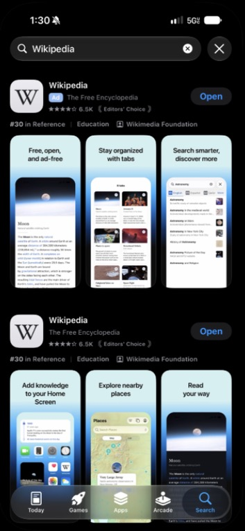
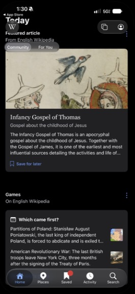

# iPhone run: Wikipedia from the App Store

Run: 2026-11-25 13:29 PT  
Device: iPhone 17 Pro Max, driven from a Mac through iPhone Mirroring (macOS) with Claude computer use

| Step | Result | Notes |
|---|---|---|
| iPhone Mirroring connected | PASS | Live home screen on the Mac |
| App Store search "Wikipedia" | PASS | Picked the organic result, not the ad slot |
| Install | PASS | Cloud button changed to **Open** in ~12 s |
| First launch + onboarding | PASS | 4 onboarding screens, Skip on the topics step |
| Home feed loads | PASS | Featured article + games cards rendered |
| In-app search | PASS | "Davis, California" returned results; article opened |

**6/6 steps passed.** Same app and same flow as the Android run, so the two platforms can be compared side by side.

