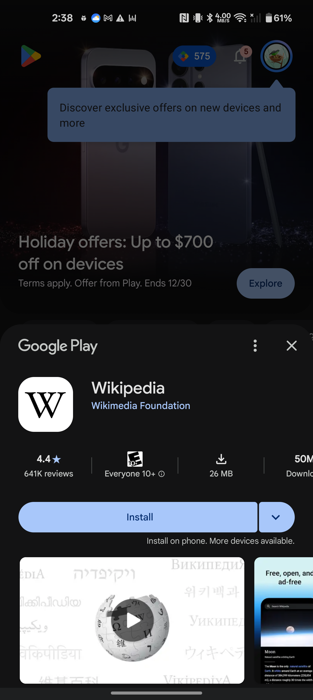
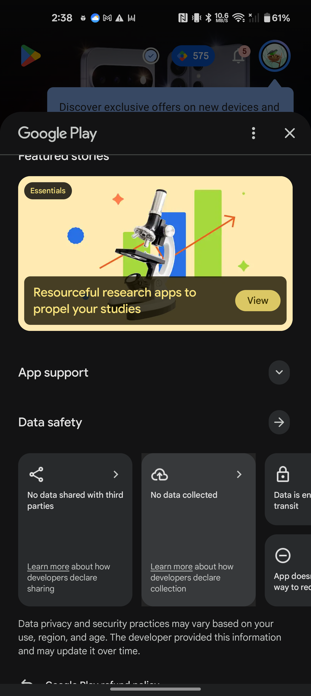

# Smoke test: `org.wikipedia`

Run: 2026-11-25 02:38  
Output: `runs/20261125-023753-org.wikipedia`

| Step | Result | Notes |
|---|---|---|
| Device connected | PASS | CPH2451, Android 15 |
| Device unlocked | PASS |  |
| Play Store listing opened | PASS | 01-play-store-listing.png |
| Install button found | PASS |  |
| Install from Play Store | PASS | 7s |
| App launches and stays running | PASS | 03-first-launch.png |
| Scroll on first screen | PASS | 04-after-scroll.png |
| No crashes in crash buffer | PASS |  |

**8/8 steps passed.**

